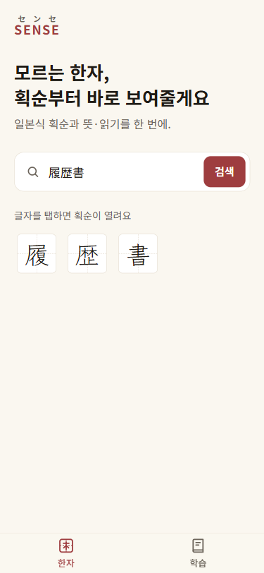
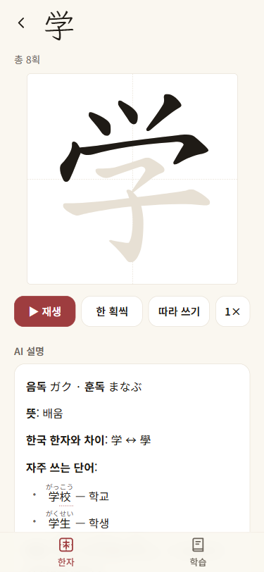
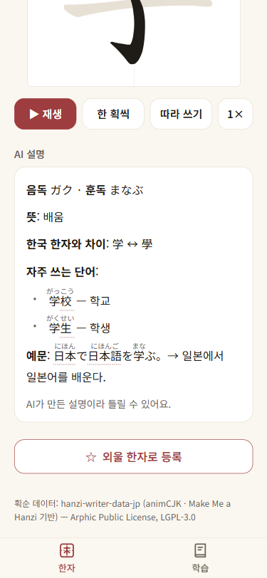

# SENSE (センセ) — 일본어 한자 획순 선생님

모르는 한자를 **검색하면 일본식 획순이 진하게 채워지며 그려지고**, AI가 **음독·훈독, 뜻, 한국 한자와의 차이, 단어, 예문**을 바로 설명해 주는 모바일 웹앱이에요.
일본 취업을 준비하는 한국인 학습자(JLPT N3~N2)가 폰으로 5~10분씩 공부하는 상황을 기준으로 만들었어요.

**👉 라이브 데모: https://jp-study-asst.vercel.app** (폰 또는 브라우저 폭 375px 기준으로 최적화)

| 한자 검색 | 획순 + AI 설명 | AI 설명 카드 |
|:--:|:--:|:--:|
|  |  |  |

---

## 목차
- [무엇을 할 수 있나요](#무엇을-할-수-있나요)
- [앱 사용법](#앱-사용법)
- [내 컴퓨터에서 실행하기](#내-컴퓨터에서-실행하기)
- [환경 변수](#환경-변수)
- [프로젝트 구조](#프로젝트-구조)
- [AI 설명 카드가 동작하는 방식](#ai-설명-카드가-동작하는-방식)
- [기술 스택](#기술-스택)
- [배포](#배포)
- [문제 해결](#문제-해결)
- [알려진 한계](#알려진-한계)
- [로드맵](#로드맵)
- [개발 참고](#개발-참고)
- [라이선스와 출처](#라이선스와-출처)

---

## 무엇을 할 수 있나요

### 지금 되는 것
- **한자 검색** — 한자·가나를 직접 입력하거나 붙여넣으면 글자별 칩이 나와요. 한 글자만 입력하면 바로 그 글자 페이지로 이동해요. 예: `履歴書` → 履 · 歴 · 書
- **일본식 획순** — 획이 채워지며 그려지는 재생, 한 획씩 보기, 따라 쓰기(퀴즈), 1×/2× 속도. 히라가나·가타카나도 지원해요.
- **AI 설명 카드** — 한자 페이지를 열면 자동으로 음독·훈독 · 뜻 · 한국 한자와의 차이(예: 学 ↔ 學) · 자주 쓰는 단어 2개 · 예문 1개가 스트리밍으로 나와요. 질문을 입력할 필요가 없어요.
- **후리가나와 한자 링크** — 단어·예문의 한자 위에 읽는 법이 붙고, 다른 한자를 탭하면 그 글자의 획순 페이지로 이동해요.
- **모바일 우선 UI** — 하단 탭(한자 · 학습), 터치 타깃 44px 이상, 가로 스크롤 없음.

### 아직 없는 것 (화면에 `준비중`으로만 표시)
문법 · 독해 · 청해 · 회화. [로드맵](#로드맵)을 참고하세요.

---

## 앱 사용법
1. 홈의 검색창에 한자(또는 한자가 섞인 단어)를 입력하고 **검색**을 눌러요.
2. 나온 글자 칩을 탭하면 **획순 화면**이 열리고 자동으로 한 번 재생돼요.
3. **한 획씩** 으로 순서를 천천히 보거나, **따라 쓰기**로 직접 써 봐요. 따라 쓰는 동안에는 화면이 스크롤되지 않아요.
4. 아래 **AI 설명**에서 읽는 법·뜻·단어·예문을 확인하고, 단어 속 점선 밑줄 한자를 탭하면 그 글자로 이동해요.

> AI가 만든 설명이라 가끔 틀릴 수 있어요. 중요한 읽기는 사전으로 한 번 더 확인해 주세요. ([알려진 한계](#알려진-한계))

---

## 내 컴퓨터에서 실행하기

### 준비물
- **Node.js 22 이상** (AI SDK 7이 요구해요. `node -v`로 확인)
- npm (Node.js와 함께 설치돼요)
- AI 설명 카드를 쓰려면 **Claude(Anthropic) API 키** — 학교·사내 프록시를 쓰면 그 주소도 (없어도 검색·획순은 동작해요)
- 획순 데이터를 CDN에서 받아오므로 **인터넷 연결**이 필요해요

### 실행
```bash
git clone https://github.com/hy0w0n/jp-study-asst.git
cd jp-study-asst
npm install

# 환경 변수 파일 만들기
cp .env.example .env.local          # PowerShell: Copy-Item .env.example .env.local
# .env.local 을 열어 ANTHROPIC_API_KEY= 뒤에 키를, 프록시를 쓰면 ANTHROPIC_BASE_URL= 뒤에 주소를 붙여넣기

npm run dev
```
브라우저에서 <http://localhost:3000> 을 열면 돼요. 모바일 화면은 브라우저 개발자 도구의 **기기 모드(375×812)**로 확인하세요. (개발 서버는 `localhost`가 아닌 다른 기기·IP에서 오는 개발용 요청을 기본으로 막아요 — 폰 실기 확인은 [배포](#배포)된 미리보기 URL을 쓰는 걸 권장해요. 자세한 설정은 Next.js의 `allowedDevOrigins` 문서 참고)

잘 되는지 확인하려면 <http://localhost:3000/kanji/学> 를 열어 보세요. 획순이 재생되고, 잠시 뒤 AI 설명이 나타나면 성공이에요.

### 업데이트 받기
```bash
git pull
npm install        # 의존성이 바뀌었을 수 있어요
```

### 명령어
| 명령어 | 하는 일 |
|---|---|
| `npm run dev` | 개발 서버 (기본 3000번 포트) |
| `npm run build` | 프로덕션 빌드 — **커밋 전에 통과해야 해요** |
| `npm run start` | 빌드한 앱 실행 |
| `npm run lint` | ESLint 검사 |

---

## 환경 변수
값은 **`.env.local`에만** 적어요. 이 파일은 git에 올라가지 않아요(`.gitignore`). `.env.example`에는 이름만 있어요.

| 이름 | 필요 | 설명 |
|---|---|---|
| `ANTHROPIC_API_KEY` | AI 카드에 필요 | Claude API 키. **서버(`/api/kanji`)에서만** 쓰이고 브라우저로 나가지 않아요. 없으면 AI 카드가 "AI 설명을 불러오지 못했어요" + **다시 시도** 버튼을 보여줘요. 나머지 기능은 그대로 동작해요. |
| `ANTHROPIC_BASE_URL` | 프록시를 쓸 때 | 학교·사내 Claude API 주소. 비우면 Anthropic 공식 주소를 써요. 끝에 `/v1`이 있어도 없어도 돼요. |
| `ANTHROPIC_MODEL` | 선택 | 사용할 모델. 기본값 `claude-haiku-5-5`. 카드가 빨리 뜨도록 생각(thinking)을 끄고 부르기 때문에, 생각을 끌 수 없는 모델(Sonnet·Opus 5.5)로 바꾸면 카드가 빈 채로 끝날 수 있어요. |
| `NEXT_PUBLIC_SUPABASE_URL`<br>`NEXT_PUBLIC_SUPABASE_PUBLISHABLE_KEY` | 지금은 불필요 | 계정 동기화(Supabase)를 위해 자리만 잡아 둔 값이에요. **현재 코드에서는 쓰지 않아요.** 비워 둬도 돼요. |

> 🔒 API 키를 코드, 커밋, 이슈, 채팅에 붙여넣지 마세요. 실수로 올렸다면 즉시 키를 폐기하고 새로 발급하세요.

---

## 프로젝트 구조
```
src/
├─ app/
│  ├─ page.tsx                   홈: 한자 검색
│  ├─ kanji/[char]/page.tsx      한자 페이지: 획순 + AI 설명 카드
│  ├─ learn/page.tsx             학습 탭: 준비중 기능 카드
│  ├─ api/kanji/route.ts         AI 설명 API (스트리밍, 한자 한 글자만 허용)
│  ├─ layout.tsx · globals.css   공통 레이아웃, 디자인 토큰(색·폰트)
├─ components/
│  ├─ KanjiSearch.tsx            검색창 + 후보 칩
│  ├─ KanjiStroke.tsx            획순 재생 · 한 획씩 · 따라 쓰기 (hanzi-writer)
│  ├─ KanjiExplain.tsx           AI 설명 카드 (자동 요청, 캐시, 오류·재시도, ruby 렌더)
│  ├─ KanjiCell.tsx              십자 가이드가 있는 연습 칸
│  ├─ BottomTabs.tsx             하단 탭 (한자 · 학습)
│  ├─ LearnFeatureList.tsx · ComingSoonSheet.tsx · SaveKanjiButton.tsx   준비중 카드와 안내 시트
└─ lib/
   ├─ ai/prompts.ts              AI 프롬프트 (수정은 이 파일에서만)
   ├─ ai/furigana.ts             {漢字|よみ} 파서
   ├─ ai/kanji-card.ts           AI 카드가 끝까지 완성됐는지 판정 (화면·서버 캐시가 같이 씀)
   ├─ kanji/loader.ts            획순 데이터 로더 (+ 히라가나 조각 획 보정)
   └─ features.ts                준비중 기능 목록
docs/                            로드맵 · 정확도 기록 · 디자인 기준 · 스크린샷 · hackathon/(해커톤 기록)
supabase/migrations/             DB 스키마 초안 (아직 적용하지 않음)
scripts/push-env.sh              .env.local 값을 Vercel 환경 변수로 등록
```

더 자세한 배경은 `docs/`에 있어요: [`ROADMAP.md`](docs/ROADMAP.md)(단계·현재 상태 — 작업 목록은 GitHub Issues) · [`ACCURACY.md`](docs/ACCURACY.md)(정확도 정책·숫자) · [`design.md`](docs/design.md)(색·폰트·간격 기준) · [`hackathon/`](docs/hackathon/)(해커톤 PRD·작업 목록·발표 메모).

---

## AI 설명 카드가 동작하는 방식
```
한자 페이지 열림 → KanjiExplain이 POST /api/kanji { char }
                  → 서버가 한 글자 한자인지 검사 → 서버 캐시에 있으면 바로 보냄
                  → 없으면 streamText(Claude) 호출 → 글자 단위로 스트리밍 (완성되면 캐시에 저장)
                  → 화면에서 {漢字|よみ}를 <ruby>로 변환
```
- **후리가나 규약:** AI는 한자가 들어간 일본어에 `{漢字|かんじ}` 형식으로 읽기를 붙이고, 화면이 이것을 `<ruby>`로 바꿔요. 닫히지 않은 `{…`는 스트리밍이 끝날 때까지 그대로 보이다가 닫히면 변환돼요.
- **출력 형식 고정:** 음독·훈독 / 뜻 / 한국 한자와 차이 / 단어 2개 / 예문 1개. 프롬프트는 [`src/lib/ai/prompts.ts`](src/lib/ai/prompts.ts) 한 곳에서만 고쳐요.
- **같은 글자는 AI를 다시 부르지 않아요.** 끝까지 완성된 설명만 서버 캐시(Vercel Runtime Cache, 7일)에 저장해 모든 사용자가 같이 써요. 브라우저에도 메모리 캐시가 있어 같은 글자는 요청 자체를 다시 보내지 않아요(새로고침하면 초기화). 로컬 개발에서는 서버 캐시가 메모리에만 있어요.
- **오류 처리:** 네트워크·서버 오류, 빈 응답, 스트리밍 도중 오류는 모두 오류 문구와 **다시 시도** 버튼으로 보여줘요.
- **키 보호:** `/api/kanji`는 한자 한 글자가 아니면 400을 돌려줘요. 임의 문장을 AI에 보내는 용도로 쓸 수 없어요.
- **사용량 보호:** 캐시에 없는 글자(= AI를 새로 부르는 요청)는 IP당 10분에 30번까지예요. 넘으면 429와 **다시 시도** 버튼이 나와요. 저장된 설명은 제한 없이 보내요.

---

## 기술 스택
| 영역 | 사용 기술 |
|---|---|
| 프레임워크 | Next.js 16 (App Router) · React 19 · TypeScript |
| 스타일 | Tailwind CSS 4 |
| AI | Vercel AI SDK 7 (`ai`, `@ai-sdk/react`, `@ai-sdk/anthropic`) · Claude `claude-haiku-5-5` (학교 API 경유) · 서버 캐시 `@vercel/functions` (Runtime Cache) |
| 획순 | [hanzi-writer](https://github.com/chanind/hanzi-writer) + 일본식 획순 데이터 `@k1low/hanzi-writer-data-jp` (jsDelivr/unpkg에서 글자별로 로드) |
| 배포 | Vercel (GitHub 연동) |
| 예정 | Supabase (익명 로그인 · RLS) — 계정 동기화용, 아직 미사용 |

---

## 배포
GitHub 저장소가 Vercel에 연결돼 있어요.
- **브랜치에 push** → 미리보기(Preview) 배포
- **`main`에 push** → 프로덕션 배포 (`jp-study-asst.vercel.app`)

포크해서 직접 배포한다면 Vercel에서 저장소를 Import하고 **Environment Variables**에 `ANTHROPIC_API_KEY`(프록시를 쓰면 `ANTHROPIC_BASE_URL`, 선택적으로 `ANTHROPIC_MODEL`)를 등록하세요. 키는 **Sensitive**를 켜고(저장 후에는 아무도 값을 다시 볼 수 없어요) **Production에만** 넣는 걸 권해요. 미리보기 URL은 로그인 없이 열리기 때문에 Preview에도 넣으면 브랜치마다 AI API가 하나씩 공개돼요. `.env.local`의 값을 한 번에 올리려면 `npx vercel link` 후 `bash scripts/push-env.sh`를 쓸 수 있어요(키는 Production에만 Sensitive로 올리고, 값은 화면에 출력되지 않아요).

---

## 문제 해결
| 증상 | 확인할 것 |
|---|---|
| `npm install`/`npm run dev`에서 Node 버전 오류 | Node.js 22 이상인지 확인 (`node -v`) |
| `localhost:3000`이 다른 앱으로 열려요 | 이미 3000번을 쓰는 앱이 있는 거예요. `npm run dev -- -p 3001`로 다른 포트를 쓰세요 |
| AI 카드가 "불러오지 못했어요" | `.env.local`에 `ANTHROPIC_API_KEY`(프록시면 `ANTHROPIC_BASE_URL`도)가 있는지, 서버를 **재시작**했는지(환경 변수는 시작할 때 읽어요), 키 사용 한도가 남았는지 확인 |
| 배포본에서만 AI 카드가 안 나와요 | Vercel **Environment Variables**에 `ANTHROPIC_*` 값을 등록했는지, 학교 API가 외부 서버(Vercel)에서 오는 요청을 허용하는지 확인 |
| 획순이 "불러오는 중…"에서 멈춰요 | 획순 데이터를 CDN에서 받아와요. 인터넷 연결과 사내망/방화벽의 jsDelivr·unpkg 차단 여부를 확인 |
| "이 글자는 획순 데이터가 없어요" | 데이터에 없는 글자예요(예: 薔). AI 설명은 그대로 나와요 |
| 폰에서 `http://<내 IP>:3000`으로 열면 화면이 깨지거나 동작이 안 돼요 | 개발 서버가 다른 호스트의 개발용 요청을 막는 기본 동작일 수 있어요(`next.config.ts`의 `allowedDevOrigins`). 폰 확인은 배포된 미리보기 URL을 쓰세요 |

---

## 알려진 한계
- **AI 설명이 틀릴 수 있어요.** 특히 훈독이 없는 한자(예: 職)에 다른 한자의 읽기를 붙이는 경우가 가끔 있어요. 프롬프트로 형식과 표기 규칙을 고정했지만, 職·履·学를 18회 호출한 측정에서 형식·표기 검사 통과는 15회(약 83%)였어요. 정확한 읽기가 꼭 필요하면 사전 데이터(예: KANJIDIC2)로 음독·훈독을 채우는 방식이 더 맞아요.
- **획순 데이터를 전수 점검하지 않았어요.** 약 6,700자의 획수를 기준 데이터와 대조하는 작업이 남아 있어요([#16](https://github.com/hy0w0n/jp-study-asst/issues/16)). 현재는 가나 13자와 한자 2자만 확인했고, 히라가나의 조각난 획은 `lib/kanji/loader.ts`에서 보정해요.
- **응답 속도:** AI 설명의 첫 글자는 보통 1~2초 안에 나오고, 전체는 2~3초 정도 걸려요(네트워크에 따라 달라요).

---

## 로드맵
**다음 순서로 계획하고 있어요**
1. 손글씨 검색 — 한 글자를 손으로 쓰면 후보 한자를 보여주기
2. 사진 검색 — 사진 속 한자 찾기
3. 내 한자장 — 외울 한자를 저장하고 따라 쓰기로 복습 (localStorage)
4. 최근 검색

**그 뒤**: 문법 · 독해 · 청해 · 회화, 계정 동기화(Supabase).

---

## 개발 참고
- **Next.js 16은 기존 버전과 다른 점이 있어요.** API·규칙이 바뀐 부분이 있으니, 코드를 쓰기 전에 `node_modules/next/dist/docs/`의 해당 문서를 먼저 읽으세요. AI SDK도 설치된 버전의 문서(`node_modules/ai/docs/`)를 기준으로 해요.
- **작업 흐름:** `feat/<이름>` 브랜치 → `npm run build` 통과 → 한국어 커밋 메시지(`feat:` · `fix:` · `docs:` …) → push → 미리보기 확인 → `main` 병합.
- **디자인 기준:** [`docs/design.md`](docs/design.md)의 토큰(색·폰트·간격)을 따라요. 순검정·순빨강은 쓰지 않아요.
- **모바일 기준 375×812:** 터치 타깃 44px 이상, 가로 스크롤 금지, 입력창 글자 16px 이상, 하단 고정 요소는 safe-area 처리.
- **AI 코딩 도구:** `AGENTS.md` / `CLAUDE.md`와 `.claude/`에 이 프로젝트의 규칙과 작업 가이드가 있어요(Claude Code용). 사람이 읽어도 프로젝트 규칙을 파악하기 좋아요.

---

## 라이선스와 출처
- **이 저장소에는 아직 `LICENSE` 파일이 없어요.** 코드를 재사용하거나 배포하기 전에 저장소 소유자([@hy0w0n](https://github.com/hy0w0n))에게 문의해 주세요.
- **획순 데이터:** `@k1low/hanzi-writer-data-jp` (animCJK · Make Me a Hanzi 기반) — Arphic Public License, LGPL-3.0. 앱 하단에도 표기돼 있어요.
- **획순 라이브러리:** [hanzi-writer](https://github.com/chanind/hanzi-writer) (MIT)
- **폰트:** Google Fonts — Noto Sans KR · Noto Sans JP · Klee One
